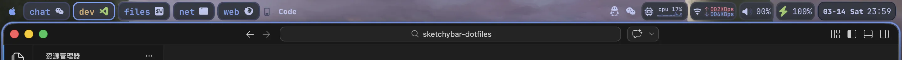

# sketchybar-dotfiles

个人 SketchyBar 配置仓库，用于自定义 macOS 菜单栏布局和信息显示。

## 效果展示



## 依赖

### 最小启动

- [SketchyBar](https://github.com/FelixKratz/SketchyBar)
- Lua
- [SbarLua](https://github.com/FelixKratz/SbarLua)
- Xcode Command Line Tools（编译 SbarLua 和 helper）

### 功能依赖

- [AeroSpace](https://github.com/nikitabobko/AeroSpace)（可选；缺失时没有 workspace 组件，menus 仍可用）
- `menus`、`cpu_load`、`network_load` helper（由安装脚本构建；构建失败时受影响 widget 会在启动时跳过）
- `SwitchAudioSource`（volume widget）
- `nowplaying-cli`（media widget，默认关闭）

### 视觉依赖

- JetBrainsMono Nerd Font
- sketchybar-app-font

字体缺失时仍可启动，但文字或图标可能 fallback、缺字。

## 使用方法

`install_sketchybar.sh` 负责安装依赖、构建 helper、同步 icon map 和检查 SbarLua；不负责创建 `~/.config/sketchybar` 链接、备份旧配置或启动 bar。

### 一键安装

```bash
git clone https://github.com/milk2715093695/sketchybar-dotfiles.git && \
  mv ~/.config/sketchybar ~/.config/sketchybar.bak 2>/dev/null; \
  ln -s "$PWD/sketchybar-dotfiles" ~/.config/sketchybar && \
  bash sketchybar-dotfiles/install_sketchybar.sh
```

### 分步安装

在希望存放仓库的目录下执行：

1. 克隆本仓库

```bash
git clone https://github.com/milk2715093695/sketchybar-dotfiles.git
```

2. 备份原有配置

```bash
mv ~/.config/sketchybar ~/.config/sketchybar.bak
```

3. 创建符号链接

```bash
ln -s "$PWD/sketchybar-dotfiles" ~/.config/sketchybar
```

4. 运行安装脚本

```bash
bash sketchybar-dotfiles/install_sketchybar.sh
```

## 权限

- `menus` helper 需要“辅助功能”权限，首次使用菜单时按系统提示授权。
- Apple 菜单中的重启、关机、锁屏、退出登录等动作通过 `osascript`/System Events 执行，可能触发“自动化”授权。

## 已知限制

- AeroSpace 当前没有 window-removed 事件；后台关闭窗口或把窗口移到其他 workspace 后，图标可能残留，切换 workspace 或执行 `sketchybar --trigger aerospace_resync` 后纠正。
- 空 workspace 默认隐藏；当前聚焦的空 workspace 显示 `-`。
- 新增 AeroSpace workspace 后需要 reload sketchybar，workspace item 才会创建。
- media widget 默认关闭，需要在 `config/settings.lua` 中启用。
- `subscribe_forward.sh` 没有自动重启；forwarder 意外退出后，事件转发会停止，需要重启 AeroSpace 或手动恢复。

## 注意

- 本仓库仅为个人配置。
- 使用前建议先备份原有配置。

## 致谢

本仓库基于以下项目进行修改和整理：

https://github.com/FelixKratz/dotfiles

感谢原作者的工作。

## 许可证

原项目使用 **GNU General Public License v3.0 (GPLv3)** 许可证发布。
由于本仓库基于该项目进行修改，根据 GPLv3 的要求，本仓库同样以 **GPLv3** 许可证发布。

有关许可证的完整内容，请参阅仓库中的 [LICENSE](./LICENSE) 文件。
